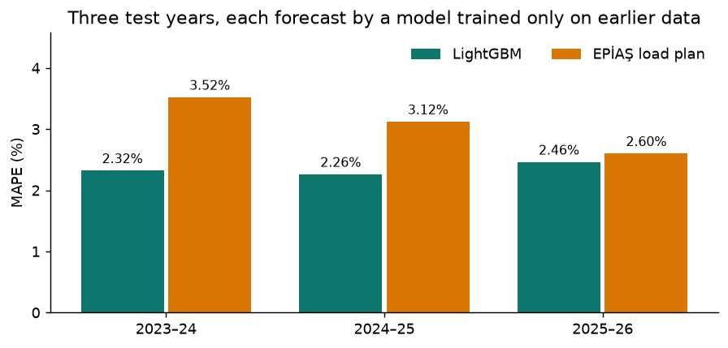
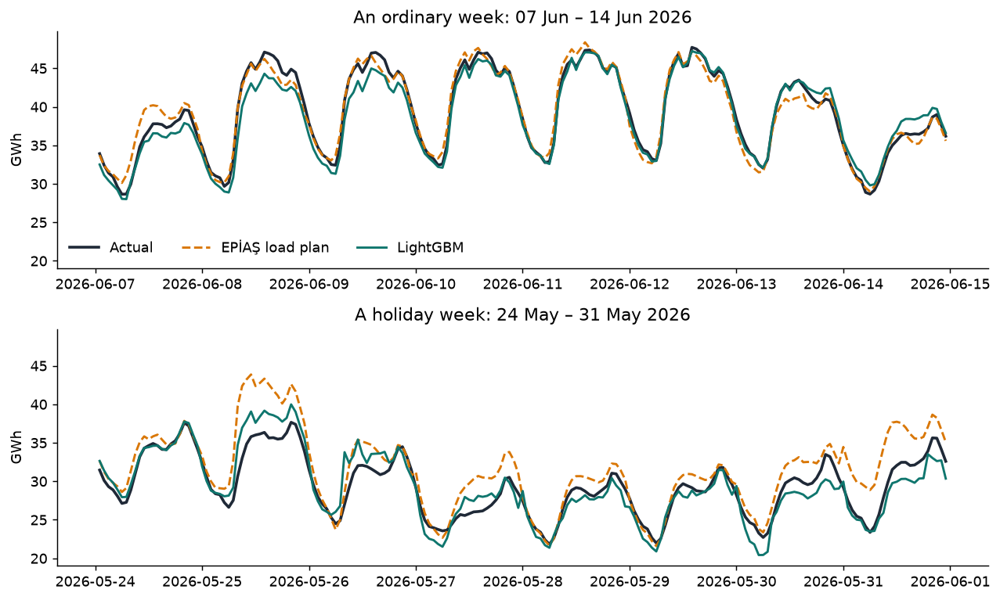
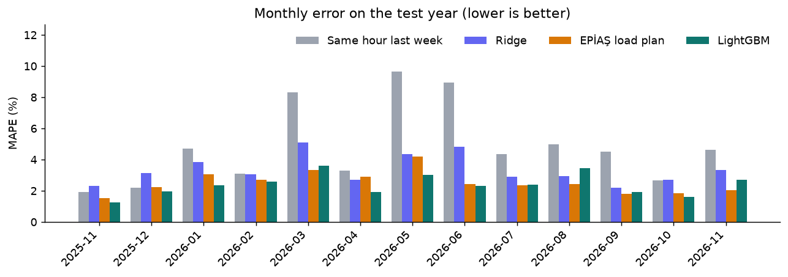

English | [Türkçe](README.tr.md)

# Türkiye Day-Ahead Electricity Demand Forecast

Every morning EPİAŞ, the Turkish energy exchange, publishes a load plan: its forecast of national electricity consumption for each hour of the next day. This project asks whether a model built only from public data can match or beat that plan under the same conditions, with nothing known that the plan would not have known.

**Result:** over three separate test years, a LightGBM model's hourly error was 2.26% to 2.46%, against 2.60% to 3.52% for the official plan. The plan has improved every year, and in the most recent year the two are statistically tied.



## How the comparison is kept honest

A forecasting result is only as good as the rules it was tested under. These are the ones this project follows:

- **The day-ahead rule.** The forecast for day D is made on the morning of D-1, when the latest complete day of consumption is D-2. Every consumption feature is therefore at least 48 hours old. [`tests/test_no_leakage.py`](tests/test_no_leakage.py) checks this by scrambling the last 47 hours of data and confirming that no feature changes. I also broke the code on purpose (a 24-hour lag) to confirm the test catches it.
- **Forecast temperature, not observed temperature.** A real forecaster does not know tomorrow's weather, only a weather forecast. The models are trained on observed temperature, which is known for the past, but on every test year they forecast with the temperature that [Open-Meteo's archived model runs](https://open-meteo.com/en/docs/previous-runs-api) predicted **two days earlier**. That run was always finished before the morning of D-1.
- **Separate test years.** Each test year is forecast by a model trained only on the data before it, and nothing from a test year is used to fit or tune anything.
- **Decisions on earlier years only.** When I tried a change to the model, I judged it on the first two test years and kept the most recent one untouched (see [What I tried](#what-i-tried-that-did-not-make-it-in)).

## Results

### The most recent year: 24 November 2025 to 23 November 2026

8,735 hours for which all four forecasts exist. MAPE is the mean absolute percentage error; MAE is in MWh.

| Model | MAPE | MAE | MAPE on holidays |
|---|---|---|---|
| Same hour one week earlier | 5.06% | 1,983 | 18.87% |
| Ridge regression | 3.40% | 1,364 | 7.16% |
| **LightGBM** | **2.46%** | **1,022** | **4.24%** |
| EPİAŞ day-ahead load plan | 2.60% | 1,045 | 4.27% |

LightGBM had the lower error on 54% of the 364 days. Its average daily error was 0.14 percentage points lower than the plan's, but the 95% interval runs from −0.11 to 0.41 (bootstrap over whole weeks, since neighbouring days are correlated). In this year the two cannot be told apart.



### Three test years

| Test year | LightGBM | EPİAŞ plan | Ridge | Same hour last week | Days LightGBM was better |
|---|---|---|---|---|---|
| Nov 2023 – Nov 2024 | **2.32%** | 3.52% | 3.47% | 5.46% | 72% |
| Nov 2024 – Nov 2025 | **2.26%** | 3.12% | 3.36% | 5.31% | 69% |
| Nov 2025 – Nov 2026 | **2.46%** | 2.60% | 3.40% | 5.06% | 54% |

Over all 1,074 days, LightGBM's daily error was 0.73 percentage points lower than the plan's, with a 95% interval of 0.55 to 1.00. The model's accuracy stayed about the same; what changed is that the plan got much better. (The first year has 8,257 scored hours because the archived forecasts have gaps in December 2023 and January 2024.)

## Where the model goes wrong

**The days after a bayram.** The worst days of the last test year are 22 to 24 March 2026, around the Ramazan Bayramı, where the model forecast 10% to 13% too little. Looking back, consumption on the first two working days after a bayram was typically about 7% below normal between 2019 and 2025 (as low as 15% below), because many people stretch the holiday. After both bayrams of 2026 it went straight back to normal (98.7% and 101%). The model expected the usual dip. The 26 days around holidays carry a MAPE of 4.79%; on the other 338 days the model's error is 2.28% against 2.39% for the plan.

**It runs low, every month.** LightGBM under-forecast in all 13 months of the last test year, by 1.3% on average, while the plan was close to unbiased (+0.1%). Tree models cannot predict above the range they were trained on, so they lag behind growing demand. The gap is widest in August (−2.9%) and March (−2.7%; still −1.75% without the bayram days), two of the five months where the plan did better (March, July, August, September and November 2026). This is the clearest thing to fix next.



## What I tried that did not make it in

- **Predicting the ratio to last week instead of the level**, a standard fix for the under-forecasting above. On the two development years it gave 2.23% against 2.32% and 2.26% against 2.26%: not a clear enough gain to adopt, so the main model is unchanged. The experiment is not part of the pipeline.
- **How much the weather adds.** With observed temperature the model would score 2.27% on the last year; with the honest two-day-ahead forecast it scores 2.46%; without any weather features 2.50%. So most of the apparent value of weather came from knowing it in advance, and an honest forecast adds only a little. This is the main reason the fair setup matters.

## Features

- **Calendar:** hour, day of week, month, a sine/cosine pair for the day of the year, weekend flag.
- **Holidays** (from the `holidays` package for Türkiye): public holidays, bayrams, half-day holidays that start at 13:00, bridge days (a working day between a holiday and a weekend) and the distance in days to the nearest bayram, capped at 7.
- **Weather:** hourly temperature for the six most populous provinces (Istanbul, Ankara, İzmir, Bursa, Antalya, Adana), combined into one national series weighted by population; heating and cooling degrees (base 18 °C and 22 °C) and a 24-hour mean.
- **Recent consumption:** lags of 48, 72, 168 and 336 hours, the mean of the last full day and the mean of the same hour over the previous week. The same hour one and two weeks earlier carry 42% and 15% of the model's gain.

## Models

The main model is LightGBM with an L1 objective; the number of trees is chosen on the last two months of each training period, and the other parameters were set once, in advance, and not tuned on any test year. It is compared with two baselines, the same hour one week earlier and a ridge regression on the same features, and with the EPİAŞ day-ahead load plan as the official benchmark.

## Limits

- The temperature forecasts are Open-Meteo's archive, not the ones EPİAŞ uses. I do not know what information the plan is built on or exactly when it is published.
- The comparison is at national level only; regional or price forecasts are not covered.
- Consumption is EPİAŞ's real-time series, which may be revised later.
- The bootstrap intervals assume weeks are independent of each other, which is closer to true than for days but not exact.

## Interactive app

`streamlit run app/streamlit_app.py` opens a page where you can pick any stretch of the test year, compare the forecasts hour by hour, see what drives the model and look at the three test years. [`tests/test_app.py`](tests/test_app.py) runs it headlessly to check that it renders.

## Project structure

```
src/fetch_consumption.py       hourly consumption and the load plan from EPİAŞ (eptr2), throttled to the API limit
src/fetch_weather.py           observed hourly temperature for six provinces (Open-Meteo archive)
src/fetch_weather_forecast.py  archived temperature forecasts made one and two days ahead (Open-Meteo Previous Runs API)
src/features.py                one row per hour: calendar, holiday, weather and lag features
src/train.py                   trains the models, scores the last year with forecast temperature
src/sensitivity.py             weather ablation and paired daily comparison with the plan
src/backtest.py                the same comparison on three test years
src/error_analysis.py          worst days, bayram recovery, monthly bias
src/report.py                  the figures in this README
app/streamlit_app.py           interactive explorer
tests/                         leakage, split and app tests
```

## Run it

You need a free account on the [EPİAŞ Transparency Platform](https://kayit.epias.com.tr/epias-transparency-platform-registration-form). Copy `.env.example` to `.env` and fill in your own credentials; `.env` is not committed. The weather data needs no account.

```bash
python3 -m venv .venv
.venv/bin/pip install -r requirements.txt -r requirements-dev.txt
.venv/bin/python -m src.fetch_consumption
.venv/bin/python -m src.fetch_weather
.venv/bin/python -m src.fetch_weather_forecast
.venv/bin/python -m src.features
.venv/bin/python -m src.train
.venv/bin/python -m src.sensitivity
.venv/bin/python -m src.backtest
.venv/bin/python -m src.error_analysis
.venv/bin/python -m src.report
.venv/bin/python -m pytest
.venv/bin/streamlit run app/streamlit_app.py
```

## Data

- Consumption and the load plan: EPİAŞ Transparency Platform, from January 2019.
- Weather: Open-Meteo historical archive (observed) and Previous Runs API (archived forecasts, from 2023).
- Holidays: the `holidays` Python package.

## Contact

Begüm Çetin · begumcetin22@gmail.com · [GitHub](https://github.com/beguumcetin)
