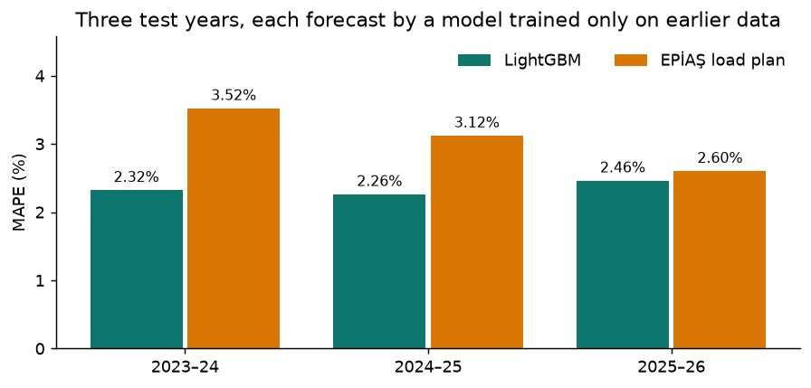
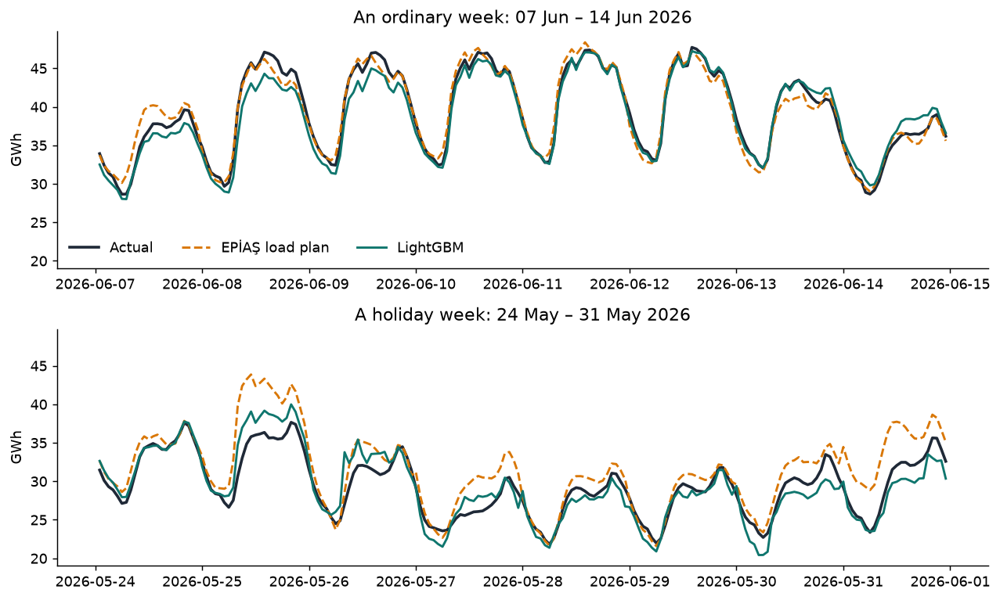
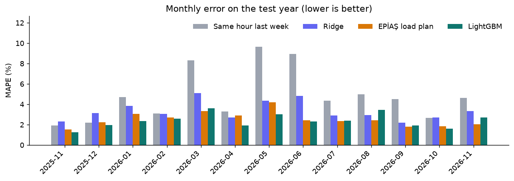

[English](README.md) | Türkçe

# Türkiye Ertesi Gün Elektrik Talep Tahmini

Türkiye enerji borsası EPİAŞ her sabah bir yük planı yayımlıyor: ertesi günün her saati için ulusal elektrik tüketimi tahmini. Bu proje şunu soruyor: yalnızca herkese açık verilerle kurulan bir model, aynı koşullarda, planın bilmeyeceği hiçbir şeyi bilmeden bu planı yakalayabilir ya da geçebilir mi?

**Sonuç:** birbirinden ayrı üç test yılında LightGBM modelinin saatlik hatası %2,26 ile %2,46 arasında kaldı; resmî planınki %2,60 ile %3,52 arasındaydı. Plan her yıl iyileşti ve son yılda ikisi istatistiksel olarak berabere.



## Karşılaştırma nasıl dürüst tutuldu

Bir tahmin sonucu, test edildiği kurallar kadar iyidir. Bu projenin uyduğu kurallar:

- **Ertesi gün kuralı.** D günü için tahmin D-1 sabahı yapılır; o anda tamamlanmış son tüketim günü D-2'dir. Bu yüzden her tüketim özelliği en az 48 saatlik. [`tests/test_no_leakage.py`](tests/test_no_leakage.py) bunu, son 47 saatin verisini karıştırıp hiçbir özelliğin değişmediğini göstererek denetliyor. Testin gerçekten işe yaradığını görmek için kodu bilerek bozdum (24 saatlik bir gecikme) ve testin bunu yakaladığını doğruladım.
- **Gerçekleşen değil, tahmin edilen sıcaklık.** Gerçek bir tahminci yarının havasını bilmez, yalnızca hava tahminini bilir. Modeller geçmiş için bilinen gerçekleşmiş sıcaklıkla eğitiliyor, ama her test yılında [Open-Meteo'nun arşivlenmiş model çalıştırmalarının](https://open-meteo.com/en/docs/previous-runs-api) **iki gün önce** tahmin ettiği sıcaklıkla tahmin yapıyor. O çalıştırma, D-1 sabahından önce her zaman tamamlanmış oluyor.
- **Ayrı test yılları.** Her test yılı, yalnızca kendisinden önceki verilerle eğitilmiş bir modelle tahmin ediliyor; test yılından hiçbir şey bir modeli eğitmek ya da ayarlamak için kullanılmıyor.
- **Kararlar yalnızca önceki yıllarda.** Modelde bir değişiklik denediğimde onu ilk iki test yılında değerlendirdim, son yılı ise hiç dokunmadan bıraktım (bkz. [Denenip alınmayanlar](#denenip-alınmayanlar)).

## Sonuçlar

### Son yıl: 24 Kasım 2025 – 23 Kasım 2026

Dört tahminin de bulunduğu 8.735 saat. MAPE ortalama mutlak yüzde hata, MAE MWh cinsinden.

| Model | MAPE | MAE | Tatillerde MAPE |
|---|---|---|---|
| Bir hafta önceki aynı saat | %5,06 | 1.983 | %18,87 |
| Ridge regresyonu | %3,40 | 1.364 | %7,16 |
| **LightGBM** | **%2,46** | **1.022** | **%4,24** |
| EPİAŞ ertesi gün yük planı | %2,60 | 1.045 | %4,27 |

LightGBM, 364 günün %54'ünde daha düşük hata verdi. Günlük hatası plandan ortalama 0,14 puan düşük, ama %95 aralığı −0,11 ile 0,41 arası (komşu günler birbirine benzediği için bütün haftalar yeniden örneklenerek). Bu yılda ikisi birbirinden ayırt edilemiyor.



### Üç test yılı

| Test yılı | LightGBM | EPİAŞ planı | Ridge | Geçen haftanın aynı saati | LightGBM'in daha iyi olduğu günler |
|---|---|---|---|---|---|
| Kas 2023 – Kas 2024 | **%2,32** | %3,52 | %3,47 | %5,46 | %72 |
| Kas 2024 – Kas 2025 | **%2,26** | %3,12 | %3,36 | %5,31 | %69 |
| Kas 2025 – Kas 2026 | **%2,46** | %2,60 | %3,40 | %5,06 | %54 |

1.074 günün tamamında LightGBM'in günlük hatası plandan 0,73 puan düşük; %95 aralığı 0,55 ile 1,00 arası. Modelin isabeti hemen hemen aynı kaldı; değişen, planın çok daha iyi hale gelmesi. (İlk yılda 8.257 saat puanlandı, çünkü arşivlenmiş tahminlerde Aralık 2023 ve Ocak 2024'te boşluklar var.)

## Model nerede yanılıyor

**Bayramdan sonraki günler.** Son test yılının en kötü günleri, Ramazan Bayramı çevresindeki 22–24 Mart 2026; model tüketimi %10–13 eksik tahmin etti. Geçmişe bakınca, 2019–2025 arasında bayramdan sonraki ilk iki iş gününde tüketim tipik olarak normalin yaklaşık %7 altındaydı (en çok %15 altı), çünkü birçok kişi tatili uzatıyor. 2026'daki iki bayramdan sonra ise tüketim hemen normale döndü (%98,7 ve %101). Model alışılmış düşüşü bekledi. Tatil çevresindeki 26 günün MAPE'si %4,79; geri kalan 338 günde modelin hatası %2,28, planınki %2,39.

**Her ay düşük tahmin ediyor.** LightGBM son test yılının 13 ayının 13'ünde de ortalama %1,3 düşük tahmin yaptı; plan ise neredeyse sapmasızdı (+%0,1). Karar ağacı modelleri eğitildikleri aralığın üstünü tahmin edemez, bu yüzden büyüyen talebin gerisinde kalırlar. Fark en çok Ağustos'ta (−%2,9) ve Mart'ta (−%2,7; bayram günleri çıkarılsa bile −%1,75) açılıyor; bu iki ay, planın daha iyi olduğu beş aydan ikisi (Mart, Temmuz, Ağustos, Eylül ve Kasım 2026). Sırada düzeltilecek en net şey bu.



## Denenip alınmayanlar

- **Seviye yerine geçen haftaya oranı tahmin etmek**, yukarıdaki düşük tahmin sorunu için standart bir çözüm. İki geliştirme yılında %2,32'ye karşı %2,23 ve %2,26'ya karşı %2,26 verdi: benimseyecek kadar net bir kazanç değil, bu yüzden ana model değişmedi. Bu deney boru hattının parçası değil.
- **Hava durumu ne kadar katkı veriyor.** Gerçekleşmiş sıcaklıkla model son yılda %2,27 alırdı; dürüst iki gün önceki tahminle %2,46 alıyor; hiç hava durumu özelliği olmadan %2,50. Yani hava durumunun görünen değerinin çoğu onu önceden bilmekten geliyordu, dürüst bir tahmin ise yalnızca biraz katkı veriyor. Adil kurulumun önemli olmasının ana nedeni bu.

## Özellikler

- **Takvim:** saat, haftanın günü, ay, yılın gününün sinüs/kosinüs çifti, hafta sonu işareti.
- **Tatiller** (Türkiye için `holidays` paketinden): resmî tatiller, bayramlar, 13:00'te başlayan yarım gün tatiller, köprü günleri (bir tatil ile hafta sonu arasında kalan iş günü) ve en yakın bayrama gün cinsinden uzaklık (en çok 7).
- **Hava durumu:** nüfusa göre en büyük altı il (İstanbul, Ankara, İzmir, Bursa, Antalya, Adana) için saatlik sıcaklık, nüfus ağırlıklarıyla tek bir ulusal seride birleştirilmiş; ısıtma ve soğutma dereceleri (18 °C ve 22 °C tabanlı) ve 24 saatlik ortalama.
- **Yakın geçmiş tüketim:** 48, 72, 168 ve 336 saatlik gecikmeler, son tam günün ortalaması ve bir önceki haftanın aynı saatinin ortalaması. Bir ve iki hafta önceki aynı saat, modelin kazancının %42'sini ve %15'ini taşıyor.

## Modeller

Ana model, L1 amaç fonksiyonlu LightGBM. Ağaç sayısı her eğitim döneminin son iki ayında seçiliyor; diğer parametreler baştan bir kez belirlendi ve hiçbir test yılında ayarlanmadı. İki referansla karşılaştırılıyor, bir hafta önceki aynı saat ve aynı özelliklerle kurulan Ridge regresyonu, bir de resmî ölçüt olarak EPİAŞ ertesi gün yük planıyla.

## Sınırlar

- Sıcaklık tahminleri Open-Meteo'nun arşivi, EPİAŞ'ın kullandıkları değil. Planın hangi bilgilere dayandığını ve tam olarak ne zaman yayımlandığını bilmiyorum.
- Karşılaştırma yalnızca ulusal düzeyde; bölgesel tahmin ya da fiyat tahmini kapsamda değil.
- Tüketim, EPİAŞ'ın gerçek zamanlı serisi; sonradan revize edilebilir.
- Bootstrap aralıkları haftaları birbirinden bağımsız varsayıyor; bu, günler için olduğundan gerçeğe daha yakın ama tam değil.

## Etkileşimli uygulama

`streamlit run app/streamlit_app.py`, test yılının istediğin bir dönemini seçip tahminleri saat saat karşılaştırabileceğin, modeli neyin yönlendirdiğini ve üç test yılını görebileceğin bir sayfa açıyor (arayüz İngilizce). [`tests/test_app.py`](tests/test_app.py) uygulamayı ekransız çalıştırıp hatasız açıldığını denetliyor.

## Proje yapısı

```
src/fetch_consumption.py       EPİAŞ'tan saatlik tüketim ve yük planı (eptr2), API sınırına göre yavaşlatılmış
src/fetch_weather.py           altı il için gerçekleşmiş saatlik sıcaklık (Open-Meteo arşivi)
src/fetch_weather_forecast.py  bir ve iki gün önce yapılmış arşivlenmiş sıcaklık tahminleri (Open-Meteo Previous Runs API)
src/features.py                saat başına bir satır: takvim, tatil, hava durumu ve gecikme özellikleri
src/train.py                   modelleri eğitir, son yılı tahmin edilmiş sıcaklıkla puanlar
src/sensitivity.py             hava durumu katkısı ve plana karşı günlük eşleştirilmiş karşılaştırma
src/backtest.py                aynı karşılaştırma üç test yılında
src/error_analysis.py          en kötü günler, bayram sonrası toparlanma, aylık sapma
src/report.py                  bu README'deki grafikler
app/streamlit_app.py           etkileşimli inceleme sayfası
tests/                         sızıntı, bölme ve uygulama testleri
```

## Çalıştırma

[EPİAŞ Şeffaflık Platformu](https://kayit.epias.com.tr/epias-transparency-platform-registration-form)'nda ücretsiz bir hesap gerekir. `.env.example` dosyasını `.env` olarak kopyalayıp kendi bilgilerinizle doldurun; `.env` depoya gönderilmez. Hava durumu verisi hesap gerektirmez.

```bash
python3 -m venv .venv
.venv/bin/pip install -r requirements.txt -r requirements-dev.txt
.venv/bin/python -m src.fetch_consumption
.venv/bin/python -m src.fetch_weather
.venv/bin/python -m src.fetch_weather_forecast
.venv/bin/python -m src.features
.venv/bin/python -m src.train
.venv/bin/python -m src.sensitivity
.venv/bin/python -m src.backtest
.venv/bin/python -m src.error_analysis
.venv/bin/python -m src.report
.venv/bin/python -m pytest
.venv/bin/streamlit run app/streamlit_app.py
```

## Veri

- Tüketim ve yük planı: EPİAŞ Şeffaflık Platformu, Ocak 2019'dan itibaren.
- Hava durumu: Open-Meteo tarihsel arşivi (gerçekleşen) ve Previous Runs API (arşivlenmiş tahminler, 2023'ten itibaren).
- Tatiller: `holidays` Python paketi.

## İletişim

Begüm Çetin · begumcetin22@gmail.com · [GitHub](https://github.com/beguumcetin)
